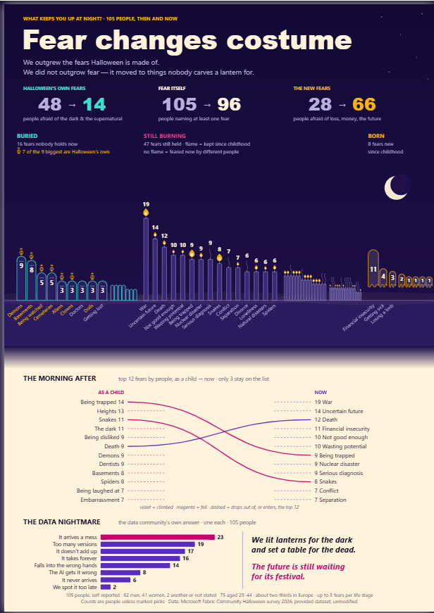

# Fear changes costume

**A one-page Power BI report for the Microsoft Fabric Community Halloween Data Visualization Contest 2026: four Deneb visuals and one footer on a portrait poster.**

> We outgrew the fears Halloween is made of.
> We did not outgrow fear. It moved to things nobody carves a lantern for.



| | |
|---|---|
| **Live report** (publish to web) | [app.powerbi.com/view?r=…](https://app.powerbi.com/view?r=eyJrIjoiZDBjMGFkNTEtOTQ4MC00Nzc2LWIwM2UtNzg5Yzk3NWVhNzJmIiwidCI6IjQ5MDk0YTAyLTRjNzktNGEyYy1iZDdmLThlZTBmMjgzN2Y0MSJ9) |
| **Contest entry** | [community.fabric.microsoft.com, *Fear changes costume*](https://community.fabric.microsoft.com/discussions/pbi_contestsgallery/fear-changes-costume/5375188) |
| **Rebuild guide** | [biventure2025.github.io/halloween-fear-pbi-deneb/docs/guide.html](https://biventure2025.github.io/halloween-fear-pbi-deneb/docs/guide.html) |
| **Closure pack** | [docs/closure.html](https://biventure2025.github.io/halloween-fear-pbi-deneb/docs/closure.html): post-mortem, plan against actual, cost |

---

## The claim, and the three numbers behind it

The contest survey asked 105 people for up to three fears **as a child** and up to three fears **now**. Every number on the page counts **people**, not picks.

| | As a child | Now | Fear categories |
|---|---:|---:|---|
| **Halloween's own fears** | **48** | **14** | Dark, Unknown & Supernatural |
| **Fear itself** (named at least one fear) | **105** | **96** | all |
| **The new fears** | **28** | **66** | Separation & Loss, Performance & Future |

The page draws the same shift fear by fear:

- **A graveyard.** 16 fears nobody holds any more are headstones. 47 fears still held are candles: a flame means at least one person kept that fear since childhood, and no flame means it is feared now by different people. 8 fears are new since childhood. Hover any of them for the before and after.
- **The morning after.** The top 12 fears as a child against the top 12 now, as a slope chart. *Death* climbs from #6 to #3, and only three fears stay in the top 12.
- **The data nightmare.** The survey's one data question gets the closing bar chart. *"It arrives a mess"* comes first with 23 of 105.

The opening animation runs once for 4.5 seconds and then stops, so the page never loops (WCAG 2.2.2).

---

## What is in this repository

```
pbip/      the Power BI Project (.pbip) as submitted: PBIR report + TMDL semantic model
build/     the Python that wrote the model additions and the four Deneb specs
harness/   the offline layout check: renders each spec on canvas and measures every label
docs/      the rebuild guide, the data contract, the closure pack, two page images
```

**Open `pbip/Halloween Contest 2026 - Starter File.pbip` in Power BI Desktop.** Deneb is listed in the report's `publicCustomVisuals`, so Desktop loads it from AppSource. If your tenant blocks AppSource visuals, the four Deneb visuals render blank.

### The data is not in this repository

`survey_responses.csv` belongs to the contest. The starter model reads it from the **contest's own public URL** (`expressions.tmdl`, `raw_survey_responses`), so refreshing the model fetches it from there. That URL is controlled by the contest organisers and **may stop answering after the contest ends**. If it does, download the CSV from the contest page and point the `raw_survey_responses` expression at your local copy. The imported data cache (`.pbi/cache.abf`) is left out of this repository for the same reason.

---

## Three things that went wrong, and the rule each one left

1. **A hover card leaked onto the idle page.** Vega's **canvas** renderer, which Deneb used here by default, does **not** pass a group's `opacity` down to the marks inside the group. The SVG renderer does. So a hover card that was invisible in every SVG test showed its labels on the page in Desktop. **Rule:** give every child of a hover group its own opacity, and test layouts on canvas. A lint rule for this pattern now runs on every report this toolchain builds.
2. **"The text is too small" came back three times.** Each spec was sized in canvas pixels, but Desktop showed the 1357 × 1920 page at about 0.47×. **Rule:** set a type floor **at page scale** (15 px here) before drawing anything, and choose the page view (Fit to width) in the mockup. Every `text` mark asserts the floor when the spec is built.
3. **The visual header icons sat on top of the "66" and the "BORN" label.** That is host chrome. No offline render can show it. **Rule:** a poster page turns the visual header off, and a look in Desktop is still required.

The [closure pack](docs/closure.html) has the full stage-by-stage post-mortem. One assumption is tested to failure there: *"an offline Deneb render is a sufficient pre-Desktop check"*.

---

## How the numbers were checked

- Every aggregate on the page was computed twice before it was drawn: by a Python replay of the starter model's own M logic over the CSV ([docs/data_contract.md](docs/data_contract.md)), and by DAX against the live model.
- After the final model change the numbers were read back from the running model: 105→96 · 48→14 · 28→66 · 16 / 47 / 8 · nightmares 23 · 19 · 17 · 16 · 14 · 8 · 6 · 2. All matched.
- The layout harness rendered the shipped specs in 19 states (idle plus one hover per kind) and measured **961 text items** for size, clipping and overlap. It found **0 issues**. It refuses to report a pass if it reads zero items.
- 19 text-on-background colour pairs, all ≥ 4.54 : 1.

---

## What this does not claim

- **105 people are not a population.** They are members of the Fabric data community who answered a Halloween survey. The page says "people", not "people in general", and the footer gives the base.
- **Childhood fears are remembered, not measured.** Each answer is an adult recalling being a child.
- **The three groups are a design choice.** Which fear categories count as "Halloween's own" and which as "the new fears" was decided when the story was written. The groupings are stated on the page, and the full category table is in the data contract.
- **"8 fears born" excludes 3 answers** ("None of these", "Prefer not to answer", "Something else") that sit in the survey's *Other Responses* category.
- **The hover states were checked on canvas offline, not photographed in Desktop.** They use the same construction as an earlier version whose hover states *were* seen in Desktop.
- The layout harness substitutes DejaVu Sans for Segoe UI. DejaVu is about 10 % wider, so the check errs on the cautious side, but it is not the real face.

---

## License

MIT, see [LICENSE](LICENSE). The survey data and the contest starter file's original pages belong to the contest organisers and are not covered by this licence.

---

Built by **Yeong Wai Son**, Kuala Lumpur, Malaysia.
Finance transformation and digital operations; Power BI, Power Platform, Azure and Fabric.
Questions or corrections: waisonyeong@gmail.com
